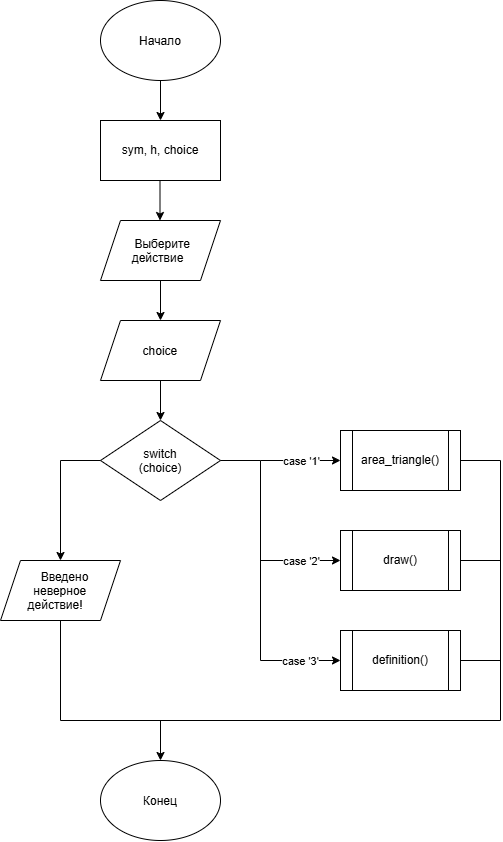
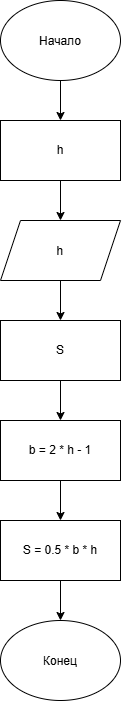
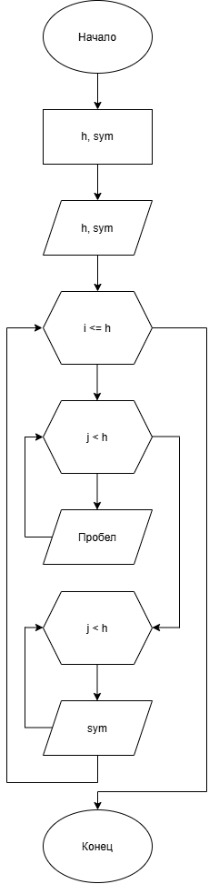
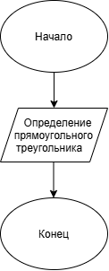

# Домашние задание к работе номер 10
## Условие Задачи
Составьте программу, которая для заданной пользователем фигуры (равнобедренный треугольник) предлагает меню выбора одной из операций:
1) рассчитать площадь;
2) вывести определение фигуры;
3) нарисовать фигуру.
## 1. Алгоритм и блок-схема
### Алгоритм:
1. Начало
2. Создаём функции area_triangle(), draw() и definition(), которые потом будут вызываться в main()
3. Объявляем переменные:
- **h** - высота треугольника;
- **sym** - символ для рисования треугольника;
- **choice** - переменная символа для switch;
4. Создаём оператор switch с 3-мя case-ами для каждой из ранее сказанных операций в задании;
5. Конец.
### Блок-схемы:
## Полностью программа

## Функция area_triangle()

## Функция draw()

## Функция definition()

## 2. Реализация программы
```c
#define _CRT_SECURE_NO_WARNINGS
#include <stdio.h>
#include <locale.h>
#include <math.h>

float area_triangle(void)
{
    int h;

    printf("Введите высоту треугольника: ");

    scanf("%d", &h);

    float S;

    float b = 2 * h - 1;

    S = 0.5 * b * h;

    return S;
}

int definition(void)
{
    puts("Равнобедренный треугольник — это треугольник, у которого две стороны равны. Эти равные стороны называются боковыми, а третья сторона —  основанием.");
}

int draw(void)
{
    int h;

    char sym;

    printf("Введите символ для рисования: ");

    scanf(" %c", &sym);

    printf("Введите высоту треугольника: ");

    scanf("%d", &h);

    for (int i = 1; i <= h; i++)
    {
        for (int j = 0; j < h - i; j++)
        {
            putchar(' ');
        }

        for (int j = 0; j < 2 * i - 1; j++)
        {
            putchar(sym);
        }

        putchar('\n');
    }

    return 0;
}

int main()
{
    setlocale(LC_ALL, "RUS");

    int h;

    char sym;

    char choice;

    puts("Выберите действие (1 - Площадь треугольника, 2 - Рисование треугольника, 3 - Определение треугольника");

    scanf(" %c", &choice);

    switch (choice) 
    {
    case '1':
        printf("Площадь треугольника: %.2f\n", area_triangle());

        break;

    case '2':
        draw();

        break;

    case '3':
        definition();

        break;

    default:
        puts("Введено неверное действие!");

        break;
    }

    return 0;
}
```
## 3. Результаты работы программы
Случай 1:
Выберите действие (1 - Площадь треугольника, 2 - Рисование треугольника, 3 - Определение треугольника
1
Введите высоту треугольника: 9
Площадь треугольника: 76,50

Случай 2:
Выберите действие (1 - Площадь треугольника, 2 - Рисование треугольника, 3 - Определение треугольника
2
Введите символ для рисования: *
Введите высоту треугольника: 5
[фигура]

Случай 3:
Выберите действие (1 - Площадь треугольника, 2 - Рисование треугольника, 3 - Определение треугольника
3
Равнобедренный треугольник - это треугольник, у которого две стороны равны. Эти равные стороны называются боковыми, а третья сторона -  основанием.
## 4. Информация о разработчике
Коваленко Вадим Валерьевич, бТИИ-261
